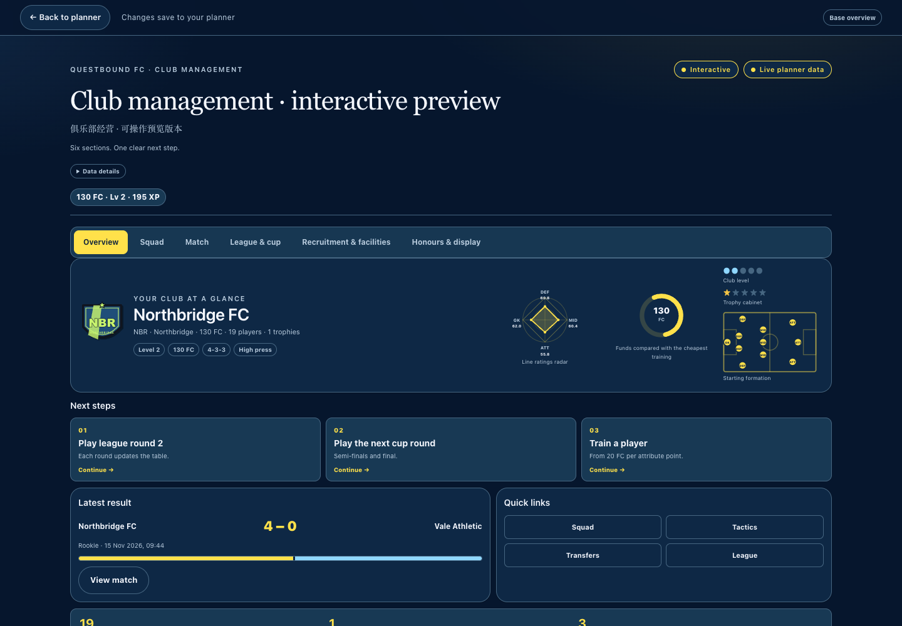
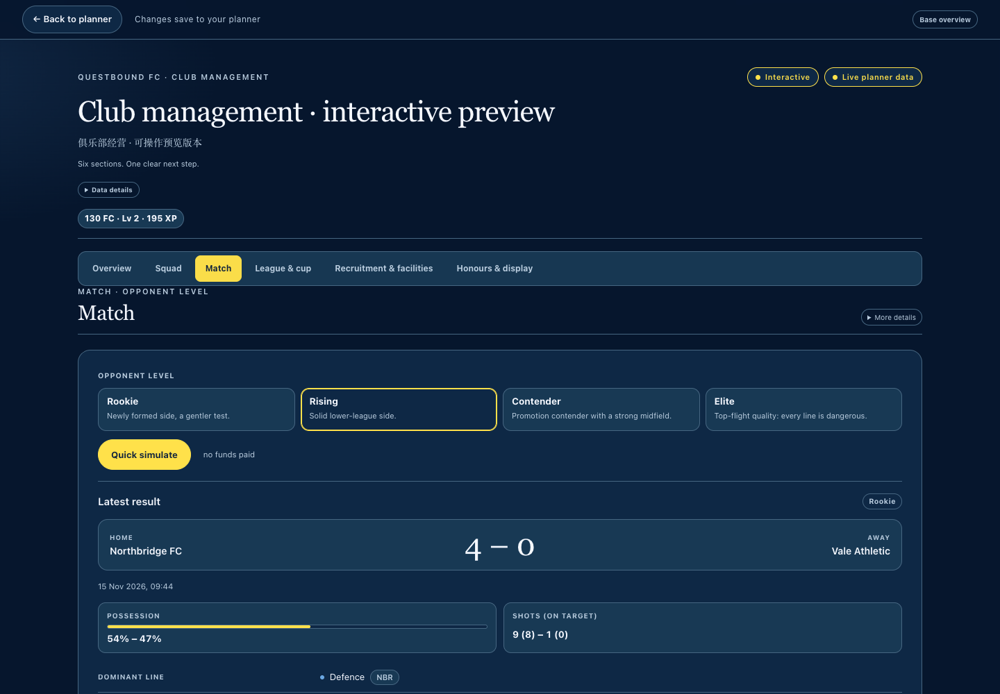
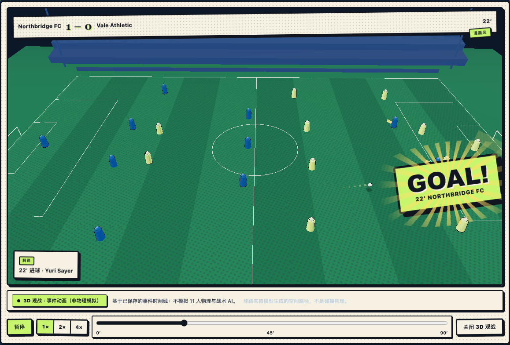
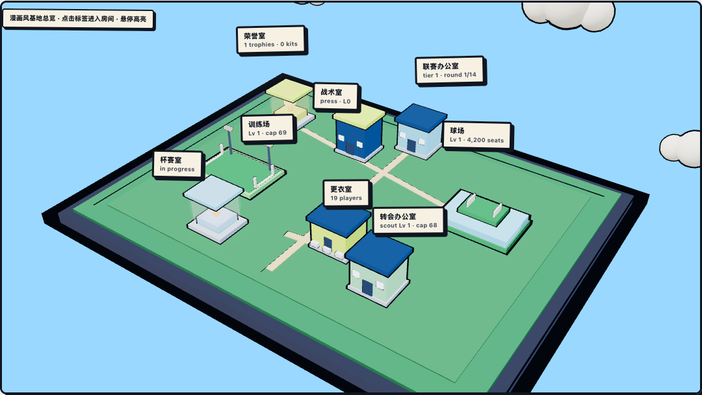
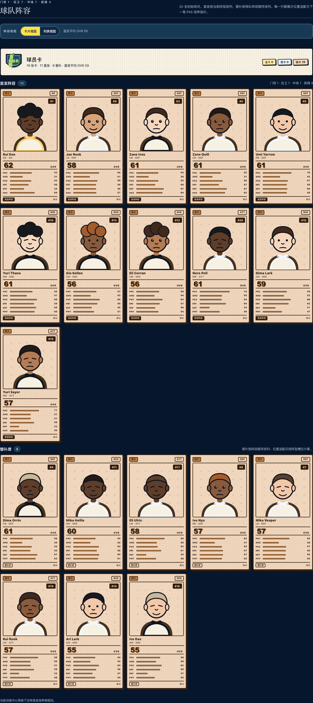

# Questbound FC

A football **club-management game** built on top of a real, working personal planner. Complete tasks and focus sessions to earn club funds and XP, then spend them on your squad, tactics, facilities, transfers and a comic-styled 3D match experience.

> Personal project. The game layer is fully functional and runs locally against the same planner document; nothing is simulated on the planning side.

**[▶ Play the browser demo](https://ryangao1006.github.io/questbound-fc/)** — a static build where the whole club game runs client-side (local storage, no account, no server). The planner and the command API need the hosted/server build.



## What it is

- **Planner (the foundation).** Quest board with main quests, habits and commitments, a day/week/month calendar with 30-minute blocks, a focus timer with pause/resume, weekly planned-vs-actual totals, offline-first IndexedDB copies, encrypted backups and a service worker.
- **Club manager (the game).** You run one club: a squad of twenty generated players, line-ups and formations, per-attribute training, tactics, facilities, transfers with real-player rosters, a four-tier league, a fictional challenge cup, honours and collectibles.
- **Reward loop.** A completed task pays 10 XP and 20 funds, a habit the same, focus pays 5 XP + 10 funds per accumulated 20 minutes (remainders carry across sessions), each new level pays 40 funds and a first club gets a one-off 150. Every reward and spend is written through a revision-checked command API with operation-id idempotency, so double clicks and two devices cannot double-spend.
- **Matches.** A possession-chain match engine: every five-minute block plays 2–4 possession chains with carriers, passes, dribbles and shots; shot quality is an **xG** model based on distance and angle, modified by the attack-vs-defence strength of the two line-ups and the chosen tactics. Matches can be quick-simulated, watched live in five-minute blocks with in-match tactics and up to five substitutions, or replayed.
- **Comic presentation.** A cel-shaded three-line art direction (a custom 4-band comic shader) covers the 3D watch and the isometric base, with ink outlines, halftone textures, a goal burst, an entrance camera sweep, stadium crowds, banners, floodlights and a full-screen trophy celebration.

## Screenshots

| | |
|---|---|
|  |  |
| Match hub with the latest result hero | Comic 3D watch — goal burst |
|  |  |
| 3D base with clickable rooms | Comic player cards |

## Features

### Club management
- Create a club (name, colours, kit), squad of 20 generated players, 4-3-3 / 4-4-2 / 4-2-3-1 formations, line-up and auto-pick.
- Line ratings from weighted attributes (DEF/MID/ATT) plus a 10 % keeper share; training one attribute at a time with a training-centre cap.
- Five tactics with training levels and real trade-offs; facilities (training centre, scout centre, stadium) with level gates.
- Fixed-price transfers from a versioned real-player roster, 50 % resale, world uniqueness, scout-centre OVR caps and a recommendations list that names your weakest line.
- Four-tier league (8 clubs, 14 rounds, promotion/relegation), a fictional four-club challenge cup with penalties, season history and honours.
- Player condition: fitness and injuries after matches, recovery on the bench, and a default assistant that keeps the eleven legal and can auto-substitute (toggleable).
- Collectibles: commemorative kits, historic line-ups, club display frames/backdrops, generated crest, stadium decorations unlocked by facilities and trophies.

### Matches
- **Quick simulation** with a post-match explanation (dominant line, where chances came from, why goals were conceded, tactic note, next step) and a per-player ratings table.
- **Live blocks**: advance the match five minutes at a time, switch tactics between blocks, make up to five substitutions, abandon without a record.
- **3D watch**: autoplays, follows the saved possession timeline (ball at the carrier's feet, passes between players, shots to the goal, centre restarts), comic HUD, speed controls, seeking, full-time stop, reduced-motion support and a WebGL fallback to text replay.
- **Storyboard and replay**: a match timeline can be replayed as text commentary or viewed as eighteen five-minute comic panels.

### Planner
- Quest board, calendar, focus timer, weekly review, habits, commitments, drafts, reminders, iCloud/Todoist adapters, offline copies and encrypted backup/restore.

## Quick start

Requirements: Node.js 22+ and pnpm (or npm).

```bash
npm install
npm run dev          # local planner + club game
```

Open the URL printed by Vite (usually http://localhost:5173), then go to `/club` for the club game and `/club/base` for the 3D base.

### Checks

```bash
npm run typecheck
npm test                      # node:test suites (529 tests)
python3 tests/migration_test.py
npm run prebuild
npm run build
```

## Architecture

| Area | Where |
|---|---|
| Planner document and reducers | `lib/model.ts`, `lib/domain.ts` |
| Command API (revision + idempotency) | `app/api/command`, `lib/store.ts`, D1 tables |
| Club domain | `lib/club-model.ts`, `lib/club-state.ts`, `lib/club-economy.ts` |
| Club features | `lib/club-{transfers,league,cup,scouting,cards,display,decor,collection,celebration,draft,lineup,actions,base}.ts` |
| Match engine v2 | `lib/match-v2.ts` (possession chains, xG, carrier timeline, live blocks) |
| 3D watch / base | `components/club-watch-3d.tsx`, `components/club-base-3d.tsx` (three.js + @react-three/fiber) |
| Comic shading | `lib/comic-material.ts`, `lib/comic-art.ts` |
| Club UI | `components/club-preview.tsx`, `app/club.css` |
| Offline / sync | `lib/site-cache.ts`, `lib/site-queue.ts`, `public/sw.js`, `worker/` |

Matches are deterministic: the same line-ups, tactics and seed always produce the same result, and a decision-free live match equals the quick simulation.

## Design references

The match engine borrows ideas from open-source football simulation and analytics projects:

- [GallagherAiden/footballSimulationEngine](https://github.com/GallagherAiden/footballSimulationEngine) — iterative possession/passing/shooting structure.
- [Dixon-Coles](https://github.com/topics/dixon-coles) — attack/defence strength thinking for goal processes.
- [finleyaf/xg_modeling-with-football-data](https://github.com/finleyaf/xg_modeling-with-football-data) and [bsobkowicz1096/Football-xG-Predictor](https://github.com/bsobkowicz1096/Football-xG-Predictor) — expected-goals shot quality.

## Licence and notes

- Released under the MIT licence (see `LICENSE`).
- Player names/ratings come from a versioned, fictionalised game roster; all ratings are original simulated values.
- Deployment identifiers for the private hosted build (`.openai/`, the Cloudflare account id) are intentionally **not** part of this repository. To deploy your own copy, configure your own Cloudflare Workers, D1 and R2 bindings and project metadata.
- The long internal release log lives in [`docs/RELEASES.md`](docs/RELEASES.md); acceptance evidence is summarised in [`ACCEPTANCE-REPORT.md`](ACCEPTANCE-REPORT.md).
